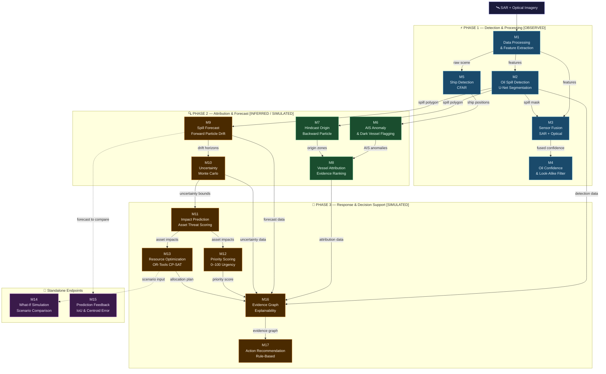

# AquaLens — Satellite Oil Spill Detection, Vessel Attribution & Response System


A full-stack, 17-module ML/AI pipeline prototype for satellite-based oil spill monitoring. The system processes synthetic SAR and optical satellite scenes end-to-end — from raw pixel detection through vessel attribution, spill forecasting, uncertainty quantification, response planning, explainability, and rule-based action recommendation — all exposed via a production-ready **FastAPI** REST interface and visualised through a **React + Vite** maritime command centre dashboard.

> [!WARNING]
> **SYNTHETIC DATA ONLY.** This system runs in `MOCK` mode. All scenes, vessels, AIS tracks, ocean data, and geographic assets are procedurally generated. Outputs are for **software architecture validation only** — they are not operational forecasts, scientific measurements, or legal attribution evidence.

---

## Table of Contents

1. [System Overview](#1-system-overview)
2. [Module Reference](#2-module-reference)
3. [Architecture & Data Flow](#3-architecture--data-flow)
4. [Project Structure](#4-project-structure)
5. [Tech Stack](#5-tech-stack)
6. [Docker](#6-docker)
7. [Installation](#7-installation)
8. [Running Locally](#8-running-locally)
9. [REST API](#9-rest-api)
10. [Pipeline Modes](#10-pipeline-modes)
11. [Per-Module API Reference](#11-per-module-api-reference)
12. [Decision Support: M16 & M17](#12-decision-support-m16--m17)
13. [Data Provenance System](#13-data-provenance-system)
14. [Configuration Reference](#14-configuration-reference)
15. [Testing](#15-testing)
16. [Integrating Real Data](#16-integrating-real-data)
17. [Disclaimers](#17-disclaimers)

---

## 1. System Overview

AquaLens is a prototype designed to answer the question:

> *"Given a satellite overpass of a suspected oil spill, what happened, who is likely responsible, what will happen next, and what should responders do?"*

The system chains 17 independent, testable modules across three operational phases:

| Phase | Modules | Purpose |
|---|---|---|
| **Detection & Processing** | M1–M5 | Extract spill boundaries, sensor confidence, and ship positions from satellite imagery |
| **Attribution & Forecast** | M6–M10 | Correlate AIS activity, estimate spill origins, forecast drift, quantify uncertainty |
| **Response & Decision Support** | M11–M17 | Score impact and urgency, optimize resource allocation, simulate scenarios, and recommend actions |

---

## 2. Module Reference

| # | Name | API Path | Provenance | Description |
|---:|---|---|---|---|
| 1 | Data Processing | `/modules/1/process` | `OBSERVED` | Multi-modal feature extraction from SAR and optical imagery |
| 2 | Oil Spill Detection | `/modules/2/detect` | `OBSERVED` | SAR-based segmentation using a U-Net interface; outputs probability maps and spill polygons |
| 3 | Sensor Fusion | `/modules/3/fuse` | `OBSERVED` | Weighted confidence fusion combining SAR and optical channel contributions |
| 4 | Oil Confidence | `/modules/4/confidence` | `OBSERVED` | Look-alike discrimination (wind slicks, biogenic films) and final confidence scoring |
| 5 | Ship Detection | `/modules/5/ships` | `OBSERVED` | CFAR-based physical vessel detection on SAR imagery |
| 6 | AIS Anomaly | `/modules/6/ais-match` | `INFERRED` | Matches satellite-detected ships against AIS tracks; flags dark vessels and gap patterns |
| 7 | Hindcast Origin | `/modules/7/hindcast` | `INFERRED` | Backward particle integration to estimate likely spill origin zones |
| 8 | Vessel Attribution | `/modules/8/attribution` | `INFERRED` | Evidence-based ranking of vessel candidates |
| 9 | Spill Forecast | `/modules/9/forecast` | `SIMULATED` | Forward particle drift simulation for 6, 12, 24, 48, and 72-hour horizons |
| 10 | Uncertainty | `/modules/10/uncertainty` | `SIMULATED` | Monte Carlo perturbation of wind/current fields |
| 11 | Impact Prediction | `/modules/11/impact` | `SIMULATED` | Evaluates threat severity to nearby assets |
| 12 | Priority Scoring | `/modules/12/priority` | `SIMULATED` | Computes a transparent 0–100 urgency score |
| 13 | Resource Optimization | `/modules/13/optimize` | `SIMULATED` | **Google OR-Tools CP-SAT** exact solver for optimal response fleet allocation |
| 14 | What-If Simulation | `/modules/14/what-if` | `SIMULATED` | **Standalone.** Compares 4 response scenarios |
| 15 | Prediction Feedback | `/modules/15/feedback` | `FEEDBACK` | **Standalone.** Computes IoU, centroid error, and recalibration factor |
| 16 | Evidence Graph | `/modules/16/evidence` | `SIMULATED` | Assembles a directed evidence graph with natural-language explanations |
| 17 | Action Recommendation | `/modules/17/recommend` | `SIMULATED` | Transparent rule-based decision support across 6 action categories |

> [!IMPORTANT]
> Modules 8, 11–14, 16, and 17 are **decision-support prototypes** using configurable heuristic weights. Vessel attribution language is circumstantial and non-legal. All recommendations require human review before any operational action.

---

## 3. Architecture & Data Flow



**Key design decisions:**
- M14 (What-If) and M15 (Prediction Feedback) are **intentionally standalone** — operators call these independently with custom scenario parameters, not as part of the main sequential pipeline.
- M16 and M17 are **synthesizers** — they consume all upstream outputs but do not re-run any module.
- Every module is independently callable via its own REST endpoint.

---

## 4. Project Structure

```
AquaLens/                           # Monorepo root
├── .gitignore
├── README.md
├── docker-compose.yml              # Orchestrates backend + frontend containers [placeholder]
│
├── Server/                         # FastAPI Python backend
│   ├── main.py                     # FastAPI app bootstrap, CORS, router mounting
│   ├── requirements.txt
│   ├── Dockerfile                  # Backend container image — Python 3.10-slim, multi-stage [placeholder]
│   ├── .dockerignore               # Excludes __pycache__, .venv, data dirs, model weights
│   │
│   ├── api/
│   │   ├── routes/
│   │   │   ├── health.py           # GET /api/v1/health
│   │   │   ├── modules.py          # POST /api/v1/modules/{1-17}/...
│   │   │   └── pipeline.py         # POST /api/v1/pipeline/run
│   │   ├── pipeline_service.py     # Service layer: run_module1() through run_module17()
│   │   ├── schemas.py              # Pydantic request/response models
│   │   └── serializers.py          # numpy -> JSON type coercion
│   │
│   ├── configs/
│   │   └── config.yaml             # All thresholds, paths, fleet defaults, MC settings
│   │
│   ├── src/
│   │   ├── data_processing/        # M1 - feature extraction pipeline
│   │   │   ├── cleaning.py
│   │   │   ├── feature_extraction.py
│   │   │   ├── loaders.py
│   │   │   ├── normalization.py
│   │   │   ├── pipeline.py
│   │   │   ├── spatial_alignment.py
│   │   │   └── temporal_alignment.py
│   │   ├── oil_spill_detection/    # M2 - U-Net inference engine
│   │   │   ├── dataset.py
│   │   │   ├── inference.py
│   │   │   ├── losses.py
│   │   │   ├── metrics.py
│   │   │   ├── postprocessing.py
│   │   │   ├── train.py
│   │   │   └── unet.py
│   │   ├── fusion/                 # M3 - SAR/optical fusion engine
│   │   │   ├── encoders.py
│   │   │   ├── fusion.py
│   │   │   ├── inference.py
│   │   │   └── model.py
│   │   ├── confidence/             # M4 - confidence and look-alike discriminator
│   │   │   ├── features.py
│   │   │   ├── inference.py
│   │   │   └── scoring.py
│   │   ├── ship_detection/         # M5 - CFAR ship detector
│   │   │   ├── detector.py
│   │   │   ├── inference.py
│   │   │   └── mock_detector.py
│   │   ├── ais/                    # M6 - AIS matcher and anomaly engine
│   │   │   ├── anomaly.py
│   │   │   ├── gap_detector.py
│   │   │   ├── matcher.py
│   │   │   └── trajectory.py
│   │   ├── hindcast/               # M7 - backward particle integrator
│   │   │   ├── integrator.py
│   │   │   ├── origin_probability.py
│   │   │   ├── particles.py
│   │   │   └── visualization.py
│   │   ├── attribution/            # M8 - vessel ranking engine
│   │   │   ├── candidate_filter.py
│   │   │   ├── explanation.py
│   │   │   ├── features.py
│   │   │   └── ranking.py
│   │   ├── forecast/               # M9 - forward plume simulator
│   │   │   ├── integrator.py
│   │   │   ├── plume.py
│   │   │   └── visualization.py
│   │   ├── uncertainty/            # M10 - Monte Carlo uncertainty engine
│   │   │   ├── eta.py
│   │   │   ├── impact.py
│   │   │   ├── monte_carlo.py
│   │   │   └── perturbations.py
│   │   ├── impact/                 # M11 - asset impact scorer
│   │   │   ├── scoring.py
│   │   │   └── sensitivity.py
│   │   ├── priority/               # M12 - priority/urgency engine
│   │   │   └── scoring.py
│   │   ├── resource_optimization/  # M13 - OR-Tools CP-SAT exact solver (greedy fallback)
│   │   │   ├── allocator.py        #   Greedy heuristic (fallback / what-if use)
│   │   │   ├── mock_fleet.py       #   Default mock fleet registry
│   │   │   └── or_tools_optimizer.py  # Primary: CP-SAT integer programming solver
│   │   ├── whatif/                 # M14 - what-if scenario simulator
│   │   │   └── simulator.py
│   │   ├── feedback/               # M15 - IoU and centroid error comparator
│   │   │   └── comparator.py
│   │   ├── explainability/         # M16 - evidence graph engine
│   │   │   └── evidence_graph.py
│   │   ├── action_recommendation/  # M17 - rule-based action recommender
│   │   │   └── recommender.py
│   │   ├── mock_data/              # Synthetic scene, AIS, ocean, and asset generators
│   │   │   ├── ais_generator.py
│   │   │   ├── generate_dataset.py
│   │   │   ├── geographic_generator.py
│   │   │   ├── ocean_generator.py
│   │   │   ├── oil_spill_generator.py
│   │   │   ├── optical_generator.py
│   │   │   ├── sar_generator.py
│   │   │   ├── scenario_generator.py
│   │   │   └── ship_generator.py
│   │   └── utils/                  # Logging, config loading, seeding, visualization
│   │       ├── config.py
│   │       ├── logging.py
│   │       ├── seed.py
│   │       └── visualization.py
│   │
│   ├── scripts/
│   │   ├── run_demo.py             # End-to-end CLI demo (--extended for M16/M17)
│   │   ├── generate_mock_data.py   # Pre-generate all synthetic data
│   │   ├── train_segmentation.py   # U-Net training script
│   │   ├── run_inference.py        # Single-scene inference
│   │   └── evaluate.py             # Model evaluation metrics
│   │
│   └── tests/
│       ├── test_api.py             # API integration tests (M1-M15, pipeline, health)
│       ├── test_modules_16_17.py   # M16, M17, extended pipeline, edge cases
│       ├── test_ais_matching.py    # AIS anomaly and matching tests
│       ├── test_attribution.py     # Vessel attribution tests
│       ├── test_confidence.py      # Oil confidence scoring tests
│       ├── test_data_processing.py # Data processing pipeline tests
│       ├── test_forecast_uncertainty.py  # Forward forecast and MC tests
│       ├── test_fusion.py          # Sensor fusion tests
│       ├── test_hindcast.py        # Hindcast origin tests
│       ├── test_segmentation.py    # U-Net segmentation tests
│       └── test_ship_detection.py  # Ship detection tests
│
└── Client/                         # React + Vite maritime dashboard
    ├── .env.example                # Template — copy to .env and set VITE_API_BASE_URL
    ├── package.json
    ├── vite.config.ts
    ├── tsconfig.json
    ├── index.html
    ├── Dockerfile                  # Frontend container — Node 20 build + Nginx serve [placeholder]
    ├── .dockerignore               # Excludes node_modules, dist, .env files
    │
    ├── public/
    │   └── assets/                 # Static map overlays and satellite imagery
    │
    └── src/
        ├── api/                    # Axios API clients for all 17 modules
        │   ├── apiClient.ts
        │   ├── endpoints.ts
        │   ├── detectionApi.ts
        │   ├── attributionApi.ts
        │   ├── forecastApi.ts
        │   ├── evidenceApi.ts
        │   ├── recommendationApi.ts
        │   └── ...                 # One file per module
        ├── app/                    # App root, providers, and router
        │   ├── App.tsx
        │   ├── AppProviders.tsx
        │   └── routes.tsx
        ├── components/
        │   ├── charts/             # Recharts visualisations
        │   │   ├── ForecastProgressionChart.tsx
        │   │   ├── ScenarioComparisonChart.tsx
        │   │   └── SensorContributionChart.tsx
        │   ├── evidence/           # Evidence graph components
        │   │   ├── EvidenceFlowGraph.tsx
        │   │   ├── EvidenceGraphView.tsx
        │   │   └── EvidenceNodeCard.tsx
        │   ├── layout/             # Sidebar, TopCommandBar, DashboardLayout
        │   │   ├── DashboardLayout.tsx
        │   │   ├── ProvenanceFooter.tsx
        │   │   ├── RecommendationBanner.tsx
        │   │   ├── Sidebar.tsx
        │   │   └── TopCommandBar.tsx
        │   ├── maps/               # Leaflet maritime map components
        │   │   ├── CommandMapFrame.tsx
        │   │   ├── LayerControl.tsx
        │   │   ├── MapLegend.tsx
        │   │   └── MaritimeMap.tsx
        │   ├── maritime/           # 3D globe, forecast timeline, vessel modal
        │   │   ├── ForecastTimeline.tsx
        │   │   ├── OceanEnvironment.tsx
        │   │   ├── SceneInspectorModal.tsx
        │   │   ├── TacticalGlobe3D.tsx
        │   │   ├── TimeLapseGallery.tsx
        │   │   └── VesselDetailModal.tsx
        │   └── ui/                 # Reusable UI primitives
        │       ├── CircularConfidence.tsx
        │       ├── CrystallinePanel.tsx
        │       ├── DataProvenanceBadge.tsx
        │       ├── DualRingSonarLens.tsx
        │       ├── MetricCard.tsx
        │       ├── ProbabilityMeter.tsx
        │       ├── RadialGauge.tsx
        │       └── ...
        ├── config/                 # Navigation and app constants
        ├── data/                   # Demo/seed data for each module
        ├── hooks/                  # React Query hooks for every module
        │   ├── useDetection.ts
        │   ├── useAttribution.ts
        │   ├── useForecast.ts
        │   └── ...
        ├── pages/                  # One page per module
        │   ├── LandingPage.tsx
        │   ├── OverviewPage.tsx
        │   ├── DetectionPage.tsx
        │   ├── AttributionPage.tsx
        │   ├── ForecastPage.tsx
        │   ├── HindcastPage.tsx
        │   ├── ImpactPage.tsx
        │   ├── ResourcesPage.tsx
        │   ├── WhatIfPage.tsx
        │   ├── EvidencePage.tsx
        │   └── FeedbackPage.tsx
        ├── schemas/                # Zod validation schemas
        ├── stores/                 # Zustand global state
        │   ├── incidentStore.ts
        │   ├── mapStore.ts
        │   ├── pipelineStore.ts
        │   └── uiStore.ts
        ├── types/                  # TypeScript API and domain types
        └── utils/                  # Formatters, provenance helpers, class names
```

---

## 5. Tech Stack

### Backend (`Server/`)

| Layer | Technology |
|---|---|
| Web framework | FastAPI 0.115+ |
| Validation | Pydantic v2 |
| ASGI server | Uvicorn |
| Deep learning | PyTorch 2.0+ |
| ML / classical | scikit-learn, XGBoost |
| Combinatorial optimization | **Google OR-Tools CP-SAT** (exact integer programming solver) |
| Numerical | NumPy 2.1+, SciPy 1.15+, Pandas 2.2+ |
| Image processing | OpenCV, Pillow |
| Geospatial | Shapely 2.0+, GeoPy |
| Config | PyYAML |
| HTTP testing | HTTPX |
| Test runner | pytest 9.0+ |

### Frontend (`Client/`)

| Layer | Technology |
|---|---|
| UI framework | React 19 + TypeScript 6 |
| Build tool | Vite 8 |
| State management | Zustand 5 |
| Data fetching | TanStack React Query 5 |
| HTTP client | Axios 1.20+ |
| Routing | React Router v7 |
| Maps | Leaflet + React-Leaflet |
| 3D rendering | Three.js 0.186+ |
| Charts | Recharts 3 |
| Animation | Framer Motion 13 |
| Validation | Zod 4 |
| Styling | Tailwind CSS 4, clsx, tailwind-merge |
| Icons | Lucide React |
| Linting | OxLint |

---

## 6. Docker

> [!NOTE]
> The Docker files are **placeholder / dummy** configurations. The project currently runs in development mode only. These are not production-ready and require proper secrets management, volume configuration, and domain setup before any deployment.

Three files are provided as a starting point:

| File | Purpose |
|---|---|
| [`docker-compose.yml`](docker-compose.yml) | Orchestrates both services — backend on `:8000`, frontend on `:80` |
| [`Server/Dockerfile`](Server/Dockerfile) | Multi-stage Python 3.10-slim image — installs deps, copies source, exposes 8000 |
| [`Client/Dockerfile`](Client/Dockerfile) | Node 20 Alpine build stage → Nginx Alpine serve stage (SPA routing + API proxy) |

### Quick Start (when ready)

```bash
# Build and start both containers
docker compose up --build

# Run backend only
docker compose up backend

# Stop all containers
docker compose down

# Stop and remove volumes
docker compose down -v
```

### Environment Variables

| Variable | Default | Description |
|---|---|---|
| `CORS_ORIGINS` | `http://localhost,http://localhost:80` | Comma-separated allowed origins for FastAPI CORS |
| `VITE_API_BASE_URL` | `http://localhost:8000` | Backend URL injected at frontend build time (`--build-arg`) |

### Service URLs (Docker)

| Service | URL |
|---|---|
| Frontend | http://localhost |
| Backend Swagger UI | http://localhost:8000/docs |
| Health Check | http://localhost:8000/api/v1/health |

---

## 7. Installation

### Requirements

| Tool | Version |
|---|---|
| Python | 3.10+ |
| Node.js | 18+ |
| npm | 9+ |

### Backend Setup

```bash
# 1. Clone the repository
git clone https://github.com/Pritosh2387/AquaLens.git
cd AquaLens

# 2. (Recommended) Create a virtual environment
python -m venv .venv
# Windows:
.venv\Scripts\activate
# macOS/Linux:
source .venv/bin/activate

# 3. Install Python dependencies
cd Server
pip install -r requirements.txt

# 4. (Optional) Pre-generate mock data
#    The API auto-generates missing data on first request if you skip this.
python scripts/generate_mock_data.py
```

All paths in `Server/configs/config.yaml` are relative to the `Server/` directory. Always run backend commands from `Server/`.

### Frontend Setup

```bash
# From the repo root:
cd Client

# 1. Install dependencies
npm install

# 2. Configure environment
cp .env.example .env
# Edit .env if your backend runs on a different port/host

# 3. Start dev server
npm run dev
```

---

## 8. Running Locally

### Manual Start

**Backend (FastAPI) — from `Server/`:**
```bash
cd Server
python -m uvicorn main:app --reload --host 127.0.0.1 --port 8000
```

**Frontend (React + Vite) — from `Client/`:**
```bash
cd Client
npm run dev
```

### Service URLs

| Service | URL |
|---|---|
| Frontend Dashboard | http://localhost:5173 |
| Backend Swagger UI | http://localhost:8000/docs |
| Backend ReDoc | http://localhost:8000/redoc |
| Health Check | http://localhost:8000/api/v1/health |

### CLI Demo (Backend Only)

The demo script runs the pipeline directly without a web server.

**Standard Demo — Modules 1–10:**
```bash
cd Server
python scripts/run_demo.py SCENE_001
```

**Extended Demo — All 17 Modules:**
```bash
cd Server
python scripts/run_demo.py SCENE_001 --extended
```

Sample extended output:
```
--- EXTENDED DEMO MODE ENABLED ---
[Module 11] Predicting Impact...       -> HIGH (severity=0.14, impact=0.69)
[Module 12] Scoring Priority...        -> 66.9 / 100  (HIGH_PRIORITY)
[Module 13] Optimizing Resources...    -> 3 assets allocated, coverage=1.00
[Module 16] Assembling Evidence Graph  -> 12 nodes, 11 edges, 5 explanations
[Module 17] Generating Recommendation  -> DEPLOY_RESOURCES

PIPELINE COMPLETE - 17-MODULE EXTENDED DEMO SUMMARY
  [M16] EXPLAINABILITY / EVIDENCE GRAPH
    Evidence Nodes   : 12
    Evidence Edges   : 11
    Provenance Stats : {OBSERVED: 4, INFERRED: 3, SIMULATED: 5}
  [M17] ACTION RECOMMENDATION
    Recommended      : DEPLOY_RESOURCES
    Priority         : HIGH_PRIORITY
    Urgency Score    : 66.88
    Confidence       : 0.7463
========================================================================
```

**Other CLI Scripts:**
```bash
cd Server
python scripts/train_segmentation.py   # Train the U-Net model
python scripts/run_inference.py SCENE_001
python scripts/evaluate.py
python -m pytest tests/ -v             # Full 243-test suite
```

---

## 9. REST API

Start the backend server, then navigate to `http://localhost:8000/docs` for the interactive Swagger UI.

### Standard Request Body (Scene-Based Modules M1–M13, M16–M17)

```json
{
  "scene_id": "SCENE_001",
  "config_path": "configs/config.yaml"
}
```

### Full Endpoint List

| Method | Path | Module | Description |
|---|---|---|---|
| `GET` | `/api/v1/health` | – | Service health; lists all 17 module statuses and API version |
| `POST` | `/api/v1/pipeline/run` | M1–M17 | Orchestrated pipeline (see Pipeline Modes) |
| `POST` | `/api/v1/modules/1/process` | M1 | Data processing and feature extraction |
| `POST` | `/api/v1/modules/2/detect` | M2 | Oil spill segmentation |
| `POST` | `/api/v1/modules/3/fuse` | M3 | SAR + optical sensor fusion |
| `POST` | `/api/v1/modules/4/confidence` | M4 | Oil confidence and look-alike assessment |
| `POST` | `/api/v1/modules/5/ships` | M5 | Physical ship detection |
| `POST` | `/api/v1/modules/6/ais-match` | M6 | AIS matching and anomaly analysis |
| `POST` | `/api/v1/modules/7/hindcast` | M7 | Spill-origin hindcast |
| `POST` | `/api/v1/modules/8/attribution` | M8 | Vessel candidate ranking |
| `POST` | `/api/v1/modules/9/forecast` | M9 | Forward drift forecast (6–72 h) |
| `POST` | `/api/v1/modules/10/uncertainty` | M10 | Monte Carlo uncertainty quantification |
| `POST` | `/api/v1/modules/11/impact` | M11 | Impact prediction and severity |
| `POST` | `/api/v1/modules/12/priority` | M12 | Priority / urgency scoring |
| `POST` | `/api/v1/modules/13/optimize` | M13 | Response fleet allocation |
| `POST` | `/api/v1/modules/14/what-if` | M14 | What-if scenario comparison *(standalone)* |
| `POST` | `/api/v1/modules/15/feedback` | M15 | Forecast vs. observation feedback *(standalone)* |
| `POST` | `/api/v1/modules/16/evidence` | M16 | Explainability / evidence graph |
| `POST` | `/api/v1/modules/17/recommend` | M17 | Action recommendation |

---

## 10. Pipeline Modes

The `/api/v1/pipeline/run` endpoint supports three execution modes.

### Mode 1 — Default (M1–M10)

```bash
curl -X POST http://localhost:8000/api/v1/pipeline/run \
  -H "Content-Type: application/json" \
  -d '{"scene_id": "SCENE_001", "config_path": "configs/config.yaml"}'
```

### Mode 2 — Extended Response (M1–M13)

Adds Impact, Priority, and Resource Optimization to the pipeline response.

```json
{
  "scene_id": "SCENE_001",
  "config_path": "configs/config.yaml",
  "include_modules_11_15": true
}
```

### Mode 3 — Full Decision Support (M1–M13, M16–M17)

Also runs the Evidence Graph and Action Recommendation.

```json
{
  "scene_id": "SCENE_001",
  "config_path": "configs/config.yaml",
  "include_modules_16_17": true
}
```

> M14 (What-If) and M15 (Prediction Feedback) are never included in the pipeline run. They are intentionally **standalone-only** endpoints.

---

## 11. Per-Module API Reference

### Module 13 — Resource Optimization (OR-Tools CP-SAT)

Module 13 uses **Google OR-Tools CP-SAT**, an exact integer programming solver, to optimally assign response fleet units to at-risk assets.

**Integer Programming formulation:**

| Element | Definition |
|---|---|
| Variable `x[i][j] ∈ {0,1}` | Assign resource unit *i* to target *j* |
| Variable `covered[j] ∈ {0,1}` | Target *j* has ≥ 1 unit assigned |
| **Objective** | Maximise `Σ asset_impact_score[j] × covered[j]` |
| Constraint 1 | Each unit used at most once |
| Constraint 2 | Max resources per target (`max_resources_per_target` in config) |
| Constraint 3 | Feasibility gate — unit can only reach target within `feasibility_horizon_hours` |
| Constraint 4 | `covered[j]` correctly linked to assignments |

The solver runs with a configurable wall-clock time limit (default **10 s**). If OR-Tools is unavailable or times out with no feasible solution, it falls back to the greedy allocator.

**Fleet override request body:**

```json
{
  "scene_id": "SCENE_001",
  "config_path": "configs/config.yaml",
  "resource_override": [
    {
      "type": "skimmer",
      "count": 2,
      "speed_knots": 8.0,
      "capacity_tons": 50.0,
      "range_km": 300.0,
      "home_lat": 12.0,
      "home_lon": 72.0
    }
  ]
}
```

### Module 14 — What-If Simulation (standalone)

```json
{
  "scene_id": "SCENE_001",
  "config_path": "configs/config.yaml",
  "scenario": "OPTIMIZED",
  "delay_hours": 0,
  "additional_resources": 0,
  "alternative_allocation": [
    { "resource_type": "skimmer", "target_asset": "COAST_ASSET_1" }
  ]
}
```

Available scenarios: `OPTIMIZED`, `DELAYED`, `NO_ACTION`, `ADDITIONAL_RESOURCES`, `ALTERNATIVE`.

### Module 15 — Prediction Feedback (standalone, no scene_id)

Directly compare two GeoJSON polygons. Coordinates must be `[longitude, latitude]` (GeoJSON order):

```json
{
  "predicted_polygon": {
    "type": "Polygon",
    "coordinates": [[[72.0,12.0],[72.3,12.0],[72.3,12.3],[72.0,12.3],[72.0,12.0]]]
  },
  "observed_polygon": {
    "type": "Polygon",
    "coordinates": [[[72.05,12.05],[72.35,12.05],[72.35,12.35],[72.05,12.35],[72.05,12.05]]]
  }
}
```

Response includes: `iou_score`, `centroid_error_km`, `area_error_km2`, `recalibration_factor`, `recalibration_label`.

---

## 12. Decision Support: M16 & M17

### Module 16 — Evidence Graph / Explainability

Assembles a **directed evidence graph** linking M2–M15 outputs into a transparent chain of evidence. Each node records:

- `source_module` — e.g., `M2`, `M8`, `M12`
- `provenance` — `OBSERVED`, `INFERRED`, `SIMULATED`, or `FEEDBACK`
- `status` — `positive`, `negative`, `verified`, `uncertain`, `simulated`, or `feedback`
- `confidence` — confidence value where applicable

Natural-language explanations generated for:

| Decision | Source Modules |
|---|---|
| `spill_credibility` | M2, M3, M4 |
| `vessel_attribution` | M6, M7, M8 |
| `priority_score` | M11, M12 |
| `resource_allocation` | M12, M13 |
| `whatif_recommendation` | M14 |
| `forecast_confidence` | M9, M10, M15 |

### Module 17 — Action Recommendation

**Action categories and trigger conditions:**

| Action | Condition |
|---|---|
| `MONITOR` | Low spill probability or confidence; no immediate threat |
| `VERIFY` | Detection probability below verification threshold; request additional imagery |
| `INVESTIGATE` | Moderate priority score; data quality warrants further investigation |
| `DEPLOY_RESOURCES` | High priority with actionable confidence; resources available |
| `URGENT_RESPONSE` | Critical priority score with high detection confidence |
| `ESCALATE` | Critical priority combined with high uncertainty or strong attribution signals |

Full response structure:

```json
{
  "recommendation": {
    "action": "DEPLOY_RESOURCES",
    "priority": "HIGH_PRIORITY",
    "urgency_score": 66.88,
    "confidence": 0.7463
  },
  "reasoning": ["Priority score 66.9 exceeds HIGH threshold of 60.0"],
  "recommended_actions": [
    {"step": "Deploy skimmer fleet to predicted 24h spill boundary", "priority": "HIGH"}
  ],
  "vessel_investigation": {
    "recommended": true,
    "vessel": "MV_TANKER_ALPHA",
    "reason": "Highest-ranked attribution candidate (circumstantial evidence only)"
  },
  "evidence_summary": "12-node evidence graph (4 OBSERVED, 3 INFERRED, 5 SIMULATED)",
  "data_type": "SIMULATED",
  "disclaimer": "Decision-support only. Not an autonomous operational command."
}
```

---

## 13. Data Provenance System

Every module output carries a provenance label. Labels are never downgraded (SIMULATED data is never relabelled as OBSERVED).

| Label | Meaning |
|---|---|
| `MOCK` | The input scene and all underlying data are synthetically generated |
| `OBSERVED` | Value derived directly from synthetic sensor data (SAR pixels, AIS messages) |
| `INFERRED` | Analytical estimate derived from one or more OBSERVED upstream outputs |
| `SIMULATED` | Output of a particle simulation, Monte Carlo run, or planning heuristic |
| `FEEDBACK` | Accuracy metric comparing a past SIMULATED forecast against a supplied observation |

The evidence graph (M16) uses these labels per-node to make the provenance chain fully auditable.

---

## 14. Configuration Reference

All system behaviour is controlled by `Server/configs/config.yaml`. Key sections:

```yaml
# Simulation settings (M7, M9)
simulation:
  num_particles: 500
  hindcast_hours: 6
  forecast_horizons: [6, 12, 24, 48, 72]

# Monte Carlo (M10)
uncertainty:
  num_simulations: 100

# Impact heuristics (M11) - prototype values only, not scientifically validated
impact:
  asset_sensitivity:
    marine_protected_area: 0.95
    fishery_zone: 0.75
    coastline: 0.80

# Priority weights (M12) - configurable
priority_scoring:
  weights:
    confidence: 0.30
    impact: 0.35
    uncertainty: 0.20
    area: 0.15

# Fleet defaults (M13)
resource_optimization:
  fleet:
    - { type: skimmer, count: 3, speed_knots: 6, capacity_tons: 100 }
    - { type: patrol_vessel, count: 4, speed_knots: 15, range_km: 500 }
    - { type: aircraft, count: 2, speed_knots: 120, range_km: 800 }

# Action recommendation thresholds (M17)
action_recommendation:
  thresholds:
    confidence_low: 0.40
    confidence_verification: 0.70
    priority_critical: 80.0
    priority_high: 60.0
    priority_medium: 40.0
```

---

## 15. Testing

The repository includes **243 fully automated tests** across 11 test files covering all 17 modules.

```bash
cd Server

# Run the full test suite
python -m pytest tests/ -v

# Run only API integration tests
python -m pytest tests/test_api.py -v

# Run only M16/M17 tests
python -m pytest tests/test_modules_16_17.py -v

# Run module-specific unit tests
python -m pytest tests/test_ais_matching.py -v
python -m pytest tests/test_attribution.py -v
python -m pytest tests/test_confidence.py -v
python -m pytest tests/test_data_processing.py -v
python -m pytest tests/test_forecast_uncertainty.py -v
python -m pytest tests/test_fusion.py -v
python -m pytest tests/test_hindcast.py -v
python -m pytest tests/test_segmentation.py -v
python -m pytest tests/test_ship_detection.py -v

# Test collection summary only
python -m pytest --collect-only -q
```

**Test coverage breakdown:**

| File | Coverage |
|---|---|
| `test_api.py` | M1–M15, pipeline flags, health endpoint, Pydantic schema validation |
| `test_modules_16_17.py` | M16, M17, extended pipeline, graceful None-handling, JSON serializability, all 6 action categories |
| `test_ais_matching.py` | AIS anomaly detection, dark vessel flagging, trajectory gap analysis |
| `test_attribution.py` | Vessel candidate filtering, ranking, evidence explanation |
| `test_confidence.py` | Oil confidence scoring, look-alike discrimination |
| `test_data_processing.py` | Feature extraction, normalization, spatial/temporal alignment |
| `test_forecast_uncertainty.py` | Forward particle drift, Monte Carlo perturbations |
| `test_fusion.py` | SAR/optical sensor fusion, weighted confidence |
| `test_hindcast.py` | Backward particle integration, origin probability |
| `test_segmentation.py` | U-Net inference, spill polygon postprocessing |
| `test_ship_detection.py` | CFAR ship detection, mock detector |

---

## 16. Integrating Real Data

The mock generators in `Server/src/mock_data/` must be replaced with real operational data sources for production use:

| Component | Replace With |
|---|---|
| SAR scenes | Calibrated Sentinel-1 GRD/SLC products (ESA SNAP preprocessed) |
| Optical scenes | Sentinel-2 L2A or cloud-filtered multispectral imagery |
| AIS tracks | Live or replayed AIS streams (MarineTraffic, ExactEarth, EMSA CleanSeaNet) |
| Ocean currents | Copernicus Marine (CMEMS) or HYCOM model outputs |
| Wind fields | ERA5 reanalysis or operational NWP forecasts |
| Geographic assets | Verified coastline, MPA, fishery zone, and port shapefiles |
| Vessel registry | Official vessel registration database (IMO records) |

All thresholds in `Server/configs/config.yaml` require calibration by domain experts using real incident data before any operational deployment.

---

## 17. Disclaimers

- **No scientific validity.** All outputs are generated from synthetic data. No module has been validated against real satellite observations.
- **No legal attribution.** Vessel rankings (M8) and investigation recommendations (M17) are based on circumstantial evidence patterns. They do not constitute legal evidence, establish causation, or support enforcement action.
- **Human oversight required.** All action recommendations (M17) are decision-support outputs intended to assist trained human operators. They are not autonomous commands.
- **Heuristic weights.** Impact sensitivity values (M11), priority scoring weights (M12), and action thresholds (M17) are configurable prototype defaults. They are not scientifically validated constants.
- **MOCK mode.** The field `"mode": "MOCK"` is present in every API response to clearly communicate that outputs are synthetic.
